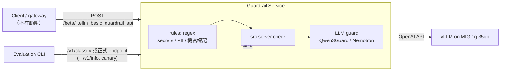

# OJT 計劃：Guardrail Server

> 對象：IMC AI-Infra 軟體工程師 · 期間：約 1 個月 · 環境：H200 **MIG 1g.35gb**（guard 模型）· 範圍：**guardrail server 本身**；呼叫端（gateway）的整合不在範圍內
> 本文件與 repo 內的程式碼是「公司外」的參考整理（內部無法直接使用 Claude），不含任何公司內部資料。

## 1. 背景與問題

- 目標：替公司內部模型服務提供 **input / output guardrail server**。呼叫端用 generic guardrail API 呼叫它；本專案只負責 server，以及直接打 server 的測試與評測。
- 現況：已嘗試 **SaaS + prompt** 的方式做初步阻擋，但表現不好。常見原因：
  1. 通用 LLM 當 judge，沒有校準過的分數，只有 yes/no → 無法調 threshold，FPR/recall 無法取捨。
  2. Policy 寫在 prompt 裡、沒有固定評測集 → 改 prompt 後無法知道整體是變好還變壞。
  3. 中文（尤其 zh-TW）與公司情境（製程術語、`kill process`、`attack surface`）的 **誤擋** 沒被量測。
  4. SaaS 延遲 / 資料外送（prompt 可能含機密）本身就是風險。
- 因此本 OJT 的主軸是：**先建立可重現的 evaluation，再用數據選資料集、模型與架構**。

## 2. 目標（Deliverables）

| # | 目標 | 產出 | 完成標準 |
|---|---|---|---|
| G1 | 找到適合公司 guardrail 需求的資料集 | `src/converters/*`、`src/config/data.yaml`、固定版本的 eval mix（`core_v1`、`zhtw_v1`） | 每個資料集有 manifest（來源、revision、license、sha256）；zh-TW 有人工審過的子集 |
| G2 | 找到適合的模型（H200 1g.35gb） | `src/config/server/models/*.yaml`、各模型 eval 結果、leaderboard | 至少 3 個候選在同一 eval mix 上比較 recall@FPR、zh-TW 切片、p95 latency |
| G3 | 自動、可重現、高品質的 evaluation 程式 | `src/evaluation/*`、`results/<run>/` | 同 config + 同資料 → 同結果；每次 run 都有 config snapshot、資料 hash、git sha、錯誤樣本 |
| G3b | 裸模型安全基準 | `src/refuse_judge` + `task: model_safety` | Qwen3.6-27B、GLM-5.3-Flash 在同一份 eval mix 上的拒答率、過度拒答率、partial 率；judge 的判斷經過人工抽查 |
| G4 | Server 上線就緒 | `src/server` + `deploy/server/`（啟動腳本、Dockerfile）+ `python -m src.server.check` | `check` 全 PASS（決策、`/ready`、auth、延遲）；啟動 config snapshot 與 `/v1/info` 的 `config_hash` 一致；p95 latency 在 MIG 上實測 |

## 3. 架構



關鍵設計決定（理由見 `docs/architecture.md`）：

1. **Server 採 generic guardrail API 協定**（`action: NONE | BLOCKED | GUARDRAIL_INTERVENED`），呼叫端不需要客製；guard 服務可以獨立部署、擴充、換模型。
2. **測試與評測直接打 server**：評測前讀 `/v1/info`（stages、`config_hash`）並送 canary，評測後再比對一次；`src.server.check` 做部署驗收（見 `docs/server.md`）。
3. **Stage pipeline**：`rules → classifier → LLM guard`，`sequential` 模式下會 short-circuit（便宜的 stage 先擋），evaluation 時用 `run_all` 收集每個 stage 的結果。
4. **分數優先於 hard label**：從 vLLM logprobs 取 P(unsafe)，才能畫 ROC、選 threshold、報 recall@FPR=1%。
5. **同一個 harness 評測 baseline**：現有 SaaS / prompt 方式用 `llm_judge_baseline.yaml` 重現，和新模型在同一份資料上比較。
6. **裸模型與 guardrail 分開量測**：`model_safety` 量模型本身的拒答行為，`guardrail` 量攔截效果。兩者共用資料、runner、metrics。

## 4. 時程（4 週，依目前進度調整）

| 週 | 主題 | 具體工作 | 檢查點 |
|---|---|---|---|
| W1 | Evaluation 基礎 + baseline | 定 schema / taxonomy；converters（Aegis2、PolyGuard、PI suite、XSTest、NotInject）；凍結 `core_v1`；跑 **現有 SaaS/prompt baseline** | baseline 報告：recall、FPR、zh 切片、latency |
| W1.5 | 裸模型基準 | 跑 Qwen3.6-27B / GLM-5.3-Flash 的 `model_safety`（thinking 開或關都測） | 模型本身「擋得住多少、誤拒多少」→ 決定 guardrail 需要多嚴 |
| W2 | 模型篩選 | vLLM 部署到 MIG；跑 Qwen3Guard-Gen 0.6B/4B/8B、Nemotron-3.5、Nemotron-8B-v3、Llama-Guard-3（英文參考）、PI classifier | leaderboard + 每個模型 `errors.csv` 人工看 50 筆 |
| W3 | zh-TW 與公司情境 | OpenCC s2twp 轉換 + 人工審；手寫 300–1000 筆 zh-TW golden set（含「看起來危險但正常」的製程/工程 prompt）；調 threshold；兩階段架構實驗 | `zhtw_v1` 結果；選定 threshold 與架構 |
| W4 | Server 交付 | 選定 preset 與 threshold；部署 vLLM + server；`src.server.check --load` 壓測 p95；`on_error`（fail-open/closed）策略；shadow 新模型；文件與交接 | 部署好的 server + check 報告 + 評測報告、runbook（`docs/server.md`） |

## 5. Server 設定與驗收

完整步驟見 [`docs/server.md`](server.md)。摘要：

```bash
MIG_UUID=MIG-xxxx MODEL=Qwen/Qwen3Guard-Gen-4B deploy/vllm/serve_guard.sh                   # guard 模型
GUARD_MODEL_BASE_URL=http://localhost:8000/v1 CONFIG=src/config/server/pipelines/two_stage.yaml deploy/server/run_server.sh
python -m src.server.check --url http://localhost:8080 --load 200                            # 驗收
python -m src.evaluation --server-url http://localhost:8080 --data processed_data/mixes/core_v1/   # 評測
```

換模型 = 用另一個 preset 重啟 server，再跑同一份評測，最後用 `src.evaluation.compare` 比較。

## 6. 評測指標（決策用）

- **主要**：`recall@FPR≤1%` / `≤5%`（企業 guard 的誤擋成本高，先固定可接受的 FPR）、各 **語言切片**（zh-TW / zh-CN / en）的 recall 與 FPR。
- **輔助**：AUROC / AUPRC、F1 + 95% bootstrap CI（樣本少時 CI 很寬，不要只看點估計）、per-category recall、per-stage 指標。
- **系統**：p50/p95/p99 latency（client 端與 server 端分開）、error rate、parse error rate。
- **Over-refusal**：XSTest / NotInject / OR-Bench-hard / 自建 zh-TW 工程情境集的 FPR。

## 7. 風險與注意事項

| 風險 | 說明 | 對策 |
|---|---|---|
| zh-TW 資料稀少 | 原生 zh-TW 只有 RTP-LX `ZH_Hant`（毒性續寫，非對話）、TS-Bench（400 筆，GitHub）、tw-PII-bench；其他中文集都是 zh-CN | RTP-LX + TS-Bench 當錨點；OpenCC 轉換 + 人工審；內部手寫公司情境 golden set |
| 資料污染 | Nemotron 系列用 Aegis/v3 訓練、Horizon 用 v3/JBB 等 → 在自家資料上分數虛高 | preset 宣告 `trained_on`，report 另算排除後的 **clean** 指標 |
| PRC 政治規範 | ChineseSafe「政治错误」、Qwen3Guard「Politically Sensitive Topics」、OpenGuardrails S2/S3 會誤擋台灣正常政治內容 | converter 預設丟棄；parser 預設忽略該類別；另建 zh-TW 政治中性測試集量測 |
| License | toxic-chat、BeaverTails、ChineseSafe 等是 NC；Llama 系列需同意 Meta license；Gemma terms | `data.yaml` 預設關閉 NC 資料；上線前請法務確認 |
| 模型來源 | Qwen / OpenGuardrails 為 PRC 來源權重 | 確認公司政策；準備 Nemotron 系列為替代 |
| MIG 算力 | 1g = 1/7 SM，prefill 是瓶頸 | 限制 `max_model_len`、截斷長輸入、短輸出（max_tokens 16–64）、壓測 |
| Output guard 無 prompt 上下文 | response 檢查時呼叫端只送 response texts | 評測預設 `response_context: none` 和正式環境一致；需要時另跑 `prompt` 實驗 |
| Streaming | post_call 對 streaming 是抽樣檢查（每 N chunk） | `streaming_sampling_rate` 調整；phase 2 評估 Qwen3Guard-Stream |
| 機密外洩 | 測試資料 / log 含公司資料 | `server.log_text: false`；`internal_rules.yaml`、`data/raw` 不進 git；config 輸出自動遮蔽 secrets |

## 8. 待確認問題（Open questions）

1. 公司 policy 的正式類別清單？（決定 taxonomy 與自訂 policy 的內容）
2. 被擋時的 UX：直接拒絕 vs. 遮罩後放行（PII）vs. 只記錄（shadow）？
3. fail-open 還是 fail-closed？是否依路由 / team 不同？
4. 是否允許 PRC 來源的模型權重？是否允許 NC 資料用於內部評測？
5. 現有 SaaS 方案是否有被標註過的歷史樣本可以拿來當 eval（`local_file` converter 可直接吃）？
6. 內部 LLM 的流量是否大量是 streaming？是否有 RAG / tool 輸出要檢查（indirect injection）？
7. Latency 預算：guard 允許增加多少 p95？
8. Server 的部署環境：k8s / VM？要幾個 replica？guard 模型的 vLLM 跟 server 放同一台機器，還是分開？
9. 呼叫端會 streaming 嗎？會的話，regex 的 `response_mask_action` 要設成 `block`（streaming 無法套用遮罩）。
